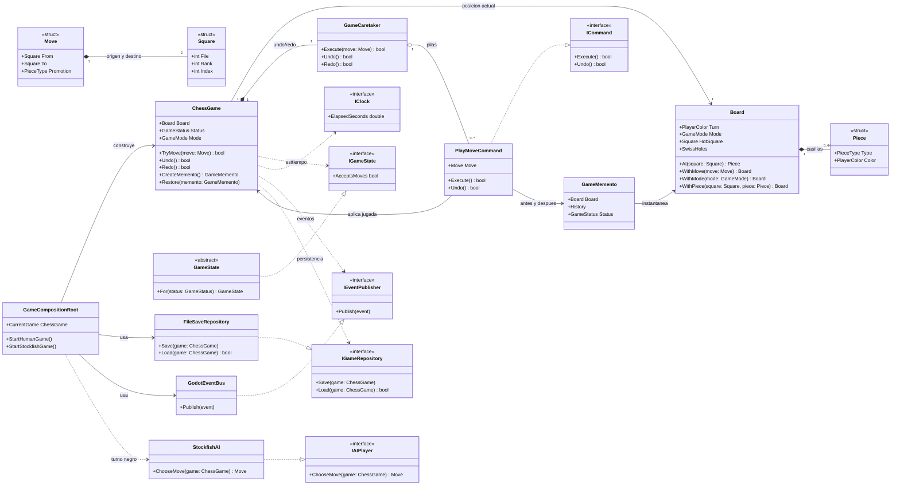
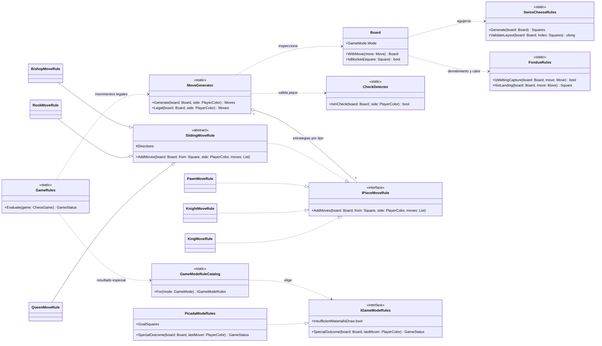

# Diagrama de clases UML — CHEESSE

**Trabajo práctico de Ingeniería de Software** · Modelo obtenido de las clases existentes en el repositorio.

Para que el diagrama se pueda leer sin reducir demasiado los nombres, se muestran **dos vistas del mismo diseño**: el dominio y sus dependencias, y las estrategias que resuelven los movimientos y las variantes. Se representan las relaciones relevantes; se omiten getters, clases de decoración visual, DTO y métodos auxiliares. Los diagramas son **editables en Mermaid** y se visualizan directamente en GitHub.

## 1. Dominio, historial y puertos

**Lectura:** los objetos de Godot quedan en el extremo de infraestructura. `ChessGame` conoce **interfaces del núcleo**, no `FileSaveRepository` ni `GodotEventBus`. `Board` contiene piezas por valor y las operaciones `With...` generan un nuevo estado.

## 2. Reglas, estrategias y variantes

**Lectura:** `MoveGenerator` selecciona una implementación de `IPieceMoveRule` según la pieza y después filtra los movimientos que dejarían al rey propio en jaque. `GameModeRuleCatalog` decide condiciones especiales como la victoria de Rey de la Picada. Queso Suizo y Fondue también tienen reglas particulares aplicadas a `Board`.

### Correspondencia con el código

- Dominio: [ChessGame](../chess-core/Model/ChessGame.cs), [Board](../chess-core/Model/Board.cs), [GameMemento](../chess-core/Model/GameMemento.cs).
- Historial: [GameCaretaker](../chess-core/Services/GameCaretaker.cs), [PlayMoveCommand](../chess-core/Services/PlayMoveCommand.cs).
- Reglas: [MoveGenerator](../chess-core/Rules/MoveGenerator.cs), [IPieceMoveRule y sus implementaciones](../chess-core/Rules/PieceMoveRules.cs), [GameModeRuleCatalog](../chess-core/Rules/GameModeRuleCatalog.cs).
- Adaptadores: [GameCompositionRoot](../chess-game/adapters/infra/GameCompositionRoot.cs), [FileSaveRepository](../chess-game/adapters/persist/FileSaveRepository.cs), [GodotEventBus](../chess-game/adapters/infra/GodotEventBus.cs), [StockfishAI](../chess-game/adapters/ai/StockfishAI.cs).

**Convenciones UML:** flecha vacía = implementación o herencia; flecha punteada = dependencia; rombo negro = composición; rombo blanco = agregación. `0..64` representa la cantidad de piezas que puede contener el tablero en el modelo, no el número de tipos de pieza.
